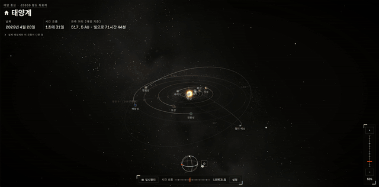

# 권정은(kwonjeongeun)의 AI UX/UI 작업

권정은의 바이브코딩 작업 모음입니다. AI와 대화하며 만든 웹 작업을 기획, 디자인 시스템, 점검 과정과 함께 남깁니다. 코드는 직접 쓰지 않았습니다.

각 작업은 브라우저에서 바로 열어 볼 수 있습니다.

## 작업

### CampusFlow v3.0 프로토타입 (2026.11.27)

대학생용 플래너 CampusFlow의 개선안 프로토타입입니다. 강의계획서를 붙여 넣으면 일정이 들어가고, 일정이 바뀌면 말 한마디로 공부 계획을 다시 맞춥니다.

[바로 보기](https://silvergarden.github.io/kwonjeongeun_ai_uxui/campusflow/) · [작업 설명](campusflow/) · [PRD](campusflow/PRD.md) · [디자인 시스템](campusflow/DESIGN.md)

### 우리 집 3D 룸 투어 (2026.11.17)

37평 집을 평면도대로 세워 걸어서 둘러보는 3D 룸 투어입니다. 공개판에는 실제 사진을 넣지 않았습니다.

[바로 보기](https://silvergarden.github.io/kwonjeongeun_ai_uxui/room-tour/) · [작업 설명](room-tour/) · [디자인 시스템](room-tour/DESIGN.md)

### 태양계 3D 모형 (2026.11.13)

행성이 실제 궤도 요소대로 공전하고, 천체를 누르면 정보 카드와 탐구 질문이 나오는 초등 6학년~중학생 과학 수업용 모형입니다.

[바로 보기](https://silvergarden.github.io/kwonjeongeun_ai_uxui/solar-system/) · [작업 설명](solar-system/) · [디자인 시스템](solar-system/DESIGN.md)

## 폴더 구성

작업마다 폴더 하나에 같은 틀로 정리합니다.

| 파일 | 내용 |
|---|---|
| `index.html` | 작업 결과물. 브라우저로 열면 됩니다. |
| `README.md` | 작업 설명, 작업 기간과 시간, 사용한 것 |
| `DESIGN.md` | 디자인 시스템 문서 |
| `linkedin-post.md` | 작업 후기 |
| `*.mp4`, `*.gif` | 시연 영상과 미리 보기 |

## 라이선스

코드는 [MIT 라이선스](LICENSE)를 따릅니다. 함께 쓴 라이브러리와 글꼴은 각 폴더의 README에 적은 원래 라이선스를 따릅니다.
