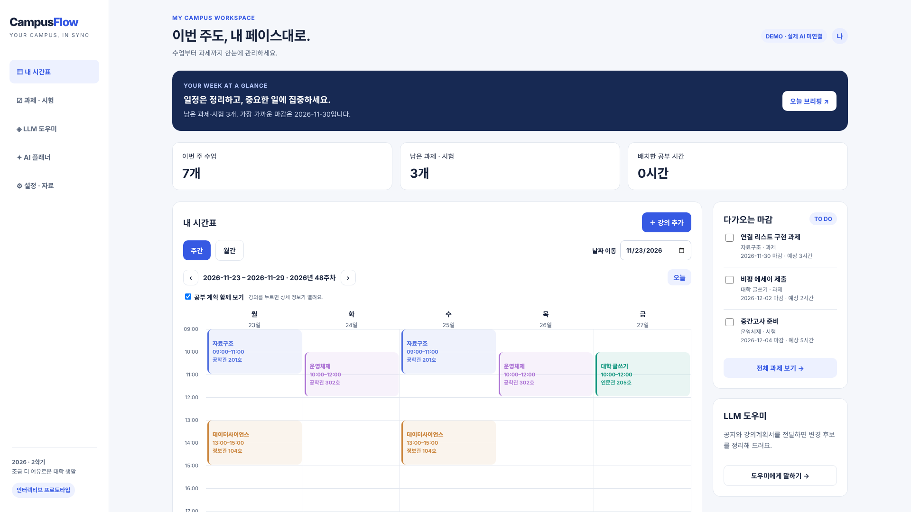
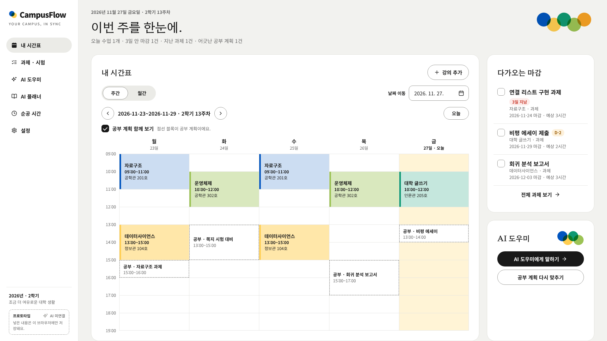

# CampusFlow v3.0 프로토타입

Fable 5.2와 대화하며 만든 대학생용 플래너 프로토타입입니다. 코드는 직접 쓰지 않았습니다.

대학 수업의 한 팀이 만든 CampusFlow를 멘토링하면서, 개선안을 직접 눌러 볼 수 있게 만든 것입니다. 원본 서비스와 아이디어는 그 팀의 것입니다.

- 바로 보기: https://claude.ai/artifact/83ALQD2SKbfv9vExN9omt7
- PRD: [PRD.md](PRD.md)
- 작업 기간: 2026. 11. 20., 2026. 11. 27.(이틀)
- 작업 시간: 약 12시간
- 대상: 대학생

## 기존과 개선

| 기존 첫 화면 | 개선한 첫 화면 (예시 데이터가 들어간 상태) |
|---|---|
|  |  |

기존 화면은 팀의 원본을 그대로 열어 찍었습니다. 두 장 모두 1920×1080입니다.

## 무엇을 하는 화면인가

1. 공지나 강의계획서를 붙여 넣으면 강의와 마감이 한 번에 들어갑니다.
2. 과목별 중요도만 고르면 빈 시간에 공부 계획이 들어갑니다.
3. 앱을 열면 다음 수업과 가장 급한 마감이 바로 보입니다.
4. 일정이 바뀌거나 공부를 못 했을 때 "수요일은 안 돼, 다시 짜 줘"라고 말하면 공부 계획이 다시 맞춰지고, 마음에 들지 않으면 되돌릴 수 있습니다.

처음 열면 비어 있습니다. 빈 시간표의 [예시 데이터로 채우기]를 누르면 예시 강의와 과제가 들어옵니다.

## 파일

| 파일 | 내용 |
|---|---|
| `index.html` | 프로토타입 전체. 브라우저로 열면 됩니다(글꼴을 받으려면 인터넷 연결 필요). |
| `PRD.md` | 한 줄 정의, 풀려는 문제, 목표, 주요 Task와 성공 기준, 메뉴별 기능 요구사항, 알려진 한계를 정리한 요구사항 문서 |
| `DESIGN.md` | 정체성, 주요 Task, 색, 서체, 버튼 위계, 문구 규칙, 빈 상태를 정리한 디자인 시스템 문서 |
| `before-home.png`, `after-home.png` | 기존 첫 화면과 개선한 첫 화면 |
| `CampusFlow-v3.0.mp4`, `CampusFlow-v3.0.gif` | 시연 영상(59초, 소리 없음). 빈 첫 화면에서 주요 Task 4개를 거쳐 채워진 모습까지 갑니다. 1분 안에 맞추려고 약 1.3배 빠르게 돌렸습니다. GIF는 Task 1 부분 17초 미리 보기 |
| `film.js`, `common.js` | 영상을 찍은 스크립트. 헤드리스 크롬으로 화면을 조작하며 녹화합니다. 작업 환경 경로에 맞춰져 있어 그대로는 실행되지 않습니다. |
| `linkedin-post.md` | 작업 후기 |

## 알아 둘 점

- AI 도우미는 Claude 아티팩트 안에서 열 때만 실제 AI에 연결됩니다. `index.html`을 파일로 열면 'AI 미연결'로 나오고, 정해진 형식의 강의계획서만 알아듣습니다. [강의계획서 예시] 버튼으로 형식을 볼 수 있습니다.
- 영상은 촬영 환경에서 실제 AI를 부를 수 없어, 강의계획서를 정리한 결과와 "수요일은 안 돼"에 대한 답을 미리 넣어 둔 응답으로 찍었습니다.
- 넣은 내용은 브라우저에만 저장됩니다. 사이드바의 로고를 누르면 빈 첫 화면으로 돌아갑니다.
- 예시 강의와 과제는 모두 가상 데이터입니다.

## 사용한 것

- [Hahmlet](https://fonts.google.com/specimen/Hahmlet), [Noto Sans KR](https://fonts.google.com/noto/specimen/Noto+Sans+KR) (SIL Open Font License)
- [PDF.js](https://mozilla.github.io/pdf.js/) 3.11.174 (Apache License 2.0). PDF를 첨부할 때만 불러옵니다.
- 아이콘: [Lucide](https://lucide.dev/) 모양을 따른 선 아이콘 (ISC)
- 디자인 참고: [Inkling](https://thinkingmachines.ai/inkling/), [Sundrop](https://trysundrop.app/), [Allo](https://allo.joshpuckett.me/)
